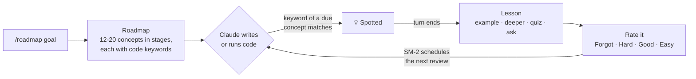

<div align="center">

# 📚 Learning Companion

**Learn while you ship.** A Claude Code plugin that turns the code Claude writes for you into lessons,
quizzes and spaced-repetition reviews, tied to a roadmap of what you want to master.

[](package.json)
[](https://claude.com/claude-code)
[](#-privacy)
[](LICENSE)

[Quick start](#-quick-start) · [How it works](#-how-it-works) · [Commands](#-commands) · [Privacy](#-privacy) · [FAQ](#-faq) · [Contributing](#-contributing)

</div>

---

## Why

AI writes the code, and you ship faster. But the routing, the ORM relationships and the queue workers
pass by without sticking. A week later you could not write them yourself.

Learning Companion catches those moments. When Claude uses a concept from your roadmap, you get a short,
interactive lesson **about the code that was just written**. Then spaced repetition brings it back right
before you would forget it.

- 🎯 **A real roadmap.** 12–20 concepts in ordered stages, from fundamentals to production.
- 👀 **Spotted in context.** Concepts are detected in what Claude writes or runs, not in a separate course.
- 🧠 **Lessons, not one-liners.** Explanation, examples, a deeper dive, a quiz, or your own question.
- 🔁 **Spaced repetition.** [SM-2](https://en.wikipedia.org/wiki/SuperMemo#Description_of_SM-2_algorithm), the algorithm behind Anki, schedules each review.
- 🎓 **A tutor on the side.** `/tutor` answers questions about the current session, even mid-turn.
- 📈 **Visible progress.** Per-stage progress bars, due reviews, and several roadmaps at once.

## 🎬 What it looks like

Claude adds a route while you work. When the turn ends:

```text
💡 Routing: Laravel's Route::get() maps an HTTP GET request for a URL to the code that answers it.
   Here, /users is sent to UserController@index, so the controller stays free of URL details.
   Grouping routes with ->middleware('auth') applies the same check to all of them at once.

┌ Lesson ──────────────────────────────────────────────────────────────┐
│ What next? (Or type a question under Other.)                        │
│  ❯ Show an example                                                  │
│    Go deeper                                                        │
│    Quiz me                                                          │
│    Rate it                                                          │
└──────────────────────────────────────────────────────────────────────┘
```

Pick **Quiz me** and answer a multiple-choice question about that code. Pick **Rate it** and the next
review is scheduled. Check where you stand at any time:

```text
> /progress

🎯 Goal: Laravel backend
████░░░░░░░░░░░░░░░░ 4/20 mastered
3 learning · 13 not started · 1 due for review

Stage 1 · Foundations (2/4)
  ✅ Routing: mastered
  ✅ Controllers and Requests: mastered
  🔁 Service Container: due for review
  ⬜ Views and Templating: not started

Stage 2 · Data (2/4)
  ✅ Database Migrations: mastered
  ✅ Eloquent ORM: mastered
  📅 Eloquent Relationships: next review 10/19/2026
  ⬜ Query Builder: not started
  …
```

## 🚀 Quick start

**Requires** [Claude Code](https://claude.com/claude-code) 2.1.288 or later (function-hook plugins).

```bash
claude plugin marketplace add Komeyl94/claude-learning-companion
claude plugin install learning-companion@learning-companion
```

Start a session and give it a goal:

```text
/roadmap Laravel backend
```

That's it. Keep working as usual: lessons show up when Claude touches a concept that is due.

## 🧭 How it works



1. **Roadmap.** Your goal becomes 12–20 concepts in 3–6 stages. Each concept has keywords as they appear
   in source code (`route::`, `hasmany`, `$table->`).
2. **Spotting.** Every `Write`, `Edit`, `MultiEdit`, `NotebookEdit` and `Bash` call is matched against the
   keywords of concepts that are due. Matching is whole-word, so `get` never fires on `target`.
   Spotting only flags the concept; the tool call itself is never slowed down.
3. **Lesson.** When the turn ends, a 3–5 sentence explanation tied to that exact code, then a menu you can
   loop through as long as you like:

   | Option | You get |
   | --- | --- |
   | **Show an example** | A different, realistic example and what to notice in it |
   | **Go deeper** | How it works underneath, a common mistake, when not to use it |
   | **Quiz me** | A multiple-choice question, marked right or wrong on the spot |
   | **Other** | Type any question about the concept |
   | **Rate it** | Ends the lesson and schedules the review |

4. **Review.** Your rating feeds SM-2: intervals grow 1 day, 6 days, then by your ease factor. A concept
   counts as **mastered** once you rate it Good or Easy at an interval over 30 days.

## ⌨️ Commands

| Command | What it does |
| --- | --- |
| `/roadmap <goal>` | Builds a roadmap. For a goal you already have, updates it instead |
| `/roadmap` | Lists your roadmaps, one line each, with progress and due reviews |
| `/roadmap update <#\|name>` | Regenerates a roadmap and **keeps your progress** |
| `/roadmap remove <#\|name>` | Deletes a roadmap and its progress, after you confirm |
| `/progress [#\|name]` | Every roadmap in full, or just one, by stage |
| `/tutor <question>` | Asks a side question at any time, even while Claude is working |

A roadmap is named by its number in `/roadmap`, its goal, or a unique part of the goal: `/progress 2`,
`/roadmap update docker`.

<details>
<summary><b>More about multiple roadmaps, updates and the tutor</b></summary>

<br>

- **Several roadmaps.** Learning Laravel and Docker at the same time? Add both. Concepts are spotted from
  every roadmap, and the status line counts them all.
- **Updates keep progress.** A concept with the same name keeps its review schedule and gets the new
  keywords. A concept you have already studied is never dropped, even when the new roadmap leaves it out.
- **`/tutor` sees your session.** Like `/btw`, it answers over the current conversation, so "why did Claude
  use a job here?" just works. It never uses tools or changes anything. In a fresh session it answers
  without that context.

</details>

## 🔒 Privacy

- **No API key, no third party.** Every model call goes through your own Claude Code session.
- **Secret files are never read.** Writes to `.env*`, `*.pem`, `*.key`, SSH keys, `credentials`,
  `secrets.*`, `.npmrc` and `.netrc` are skipped entirely.
- **Snippets are short-lived and redacted.** For other code, at most 500 characters are kept, only until
  the lesson ends. API keys, tokens, passwords, URL credentials and private keys are replaced with
  `[REDACTED]` first.
- **Local state.** Roadmaps and review schedules live in the plugin's own store under
  `~/.claude/plugins/store/`.

## ❓ FAQ

<details>
<summary><b>Does it cost extra?</b></summary>

<br>

It uses your Claude Code session, so it counts toward the usage you already have. Roadmaps and lessons
run on Haiku to keep that small. `/tutor` reuses your session's cached conversation.
</details>

<details>
<summary><b>Will it interrupt me all the time?</b></summary>

<br>

No. At most one concept is picked up per turn, only concepts that are due for review are spotted, and the
lesson waits until Claude has finished. Close the dialog at any time to skip it.
</details>

<details>
<summary><b>Does it work outside web development?</b></summary>

<br>

Yes. Any goal works: Rust, data engineering, Kubernetes, game development. Spotting works best where
concepts have distinctive APIs or keywords.
</details>

<details>
<summary><b>What happens in headless mode (<code>claude -p</code>)?</b></summary>

<br>

Commands work. Lessons need someone to answer, so they are skipped.
</details>

<details>
<summary><b>I used version 2.0. Is my roadmap lost?</b></summary>

<br>

No. A 2.0 roadmap is upgraded on load. Run `/roadmap update 1` to grow it to a full roadmap while keeping
your review history.
</details>

## 🛠️ Contributing

Issues and pull requests are welcome.

```bash
git clone https://github.com/Komeyl94/claude-learning-companion.git
cd claude-learning-companion
claude --plugin-dir .            # run Claude Code with your local copy
claude plugin test .             # run the test suites
claude plugin validate --strict .
```

| Path | Role |
| --- | --- |
| [`hooks/register.ts`](hooks/register.ts) | Hooks: commands, concept spotting (`tool.call`), lessons (`turn.complete`), the tutor |
| [`hooks/sm2.ts`](hooks/sm2.ts) | Pure logic: SM-2, keyword matching, roadmap merging, parsing, progress views |
| [`tests/`](tests) | Suites for `claude plugin test` |

Keep pure logic in `sm2.ts` so it can be tested without the engine, and add a test with each change.

## 📄 License

[MIT](LICENSE) © Komeyl Mohebian
