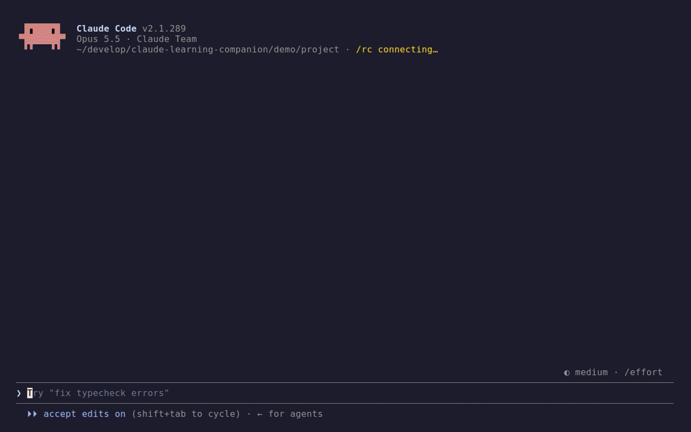
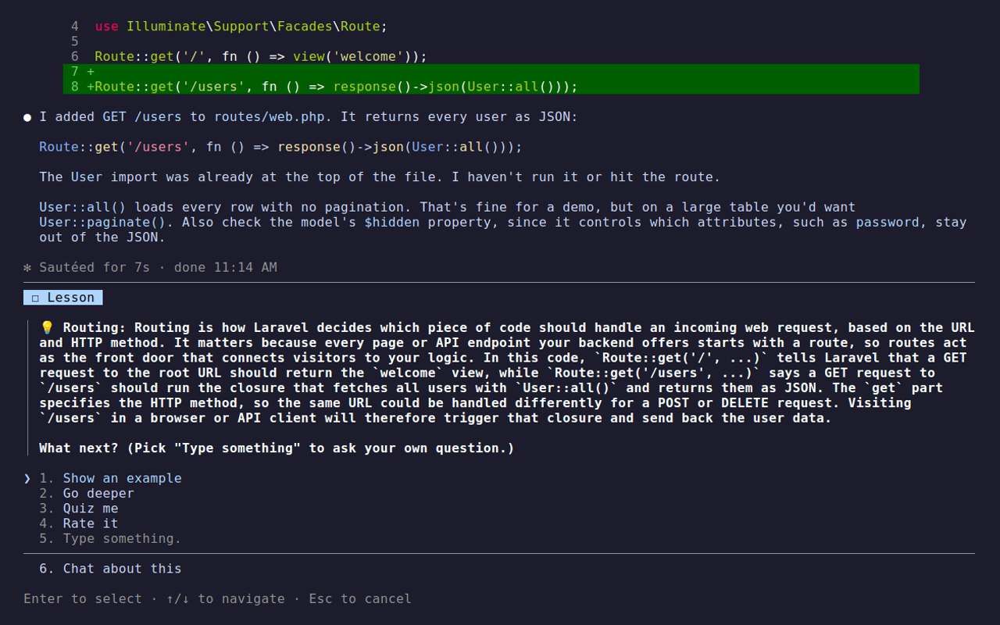
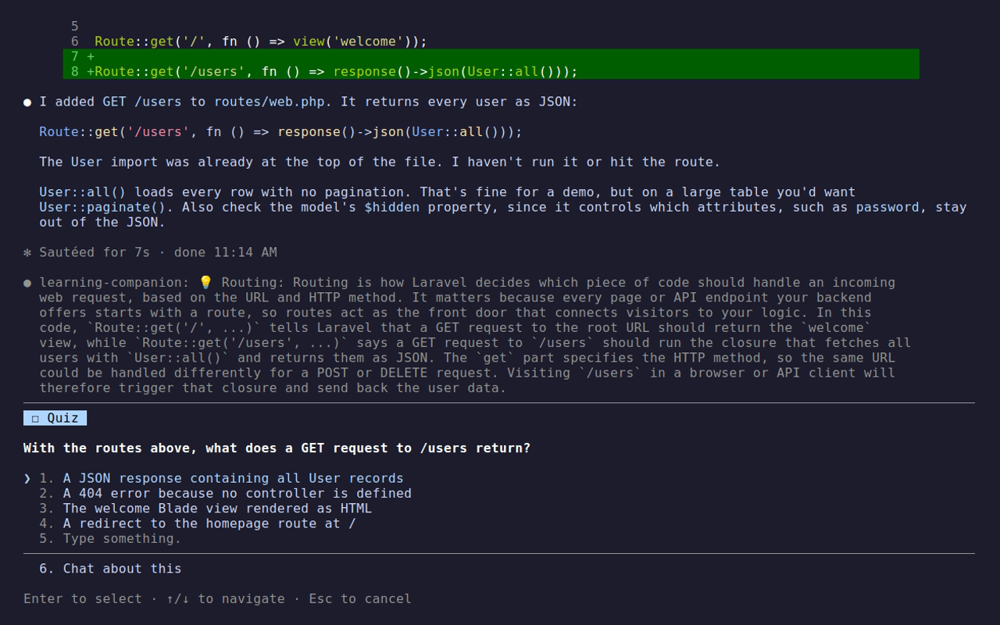
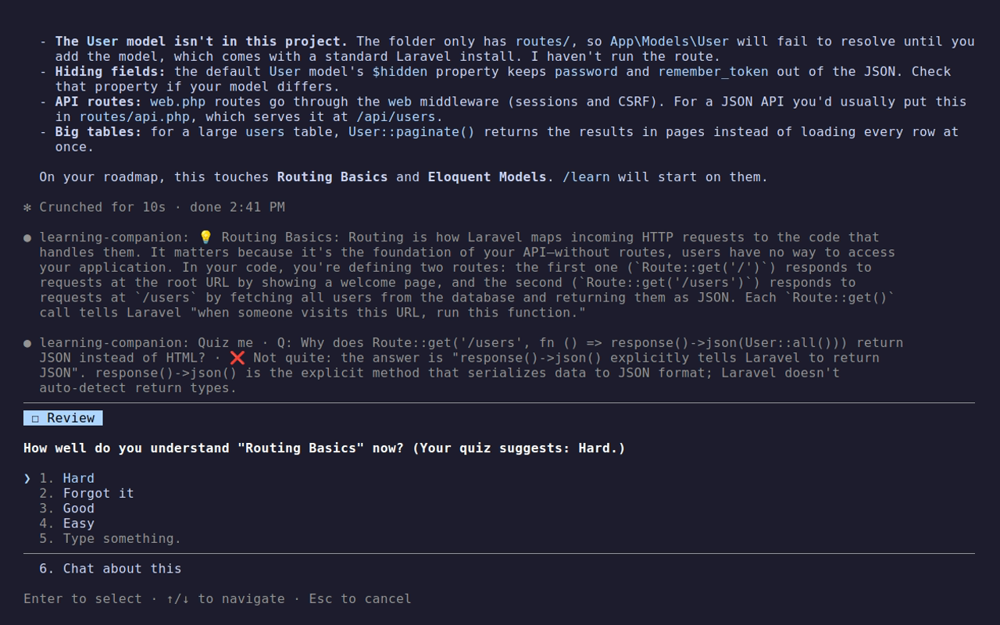
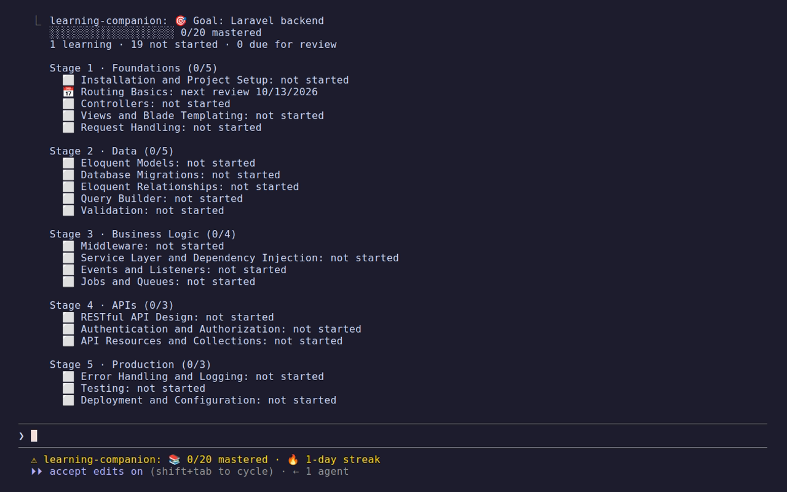
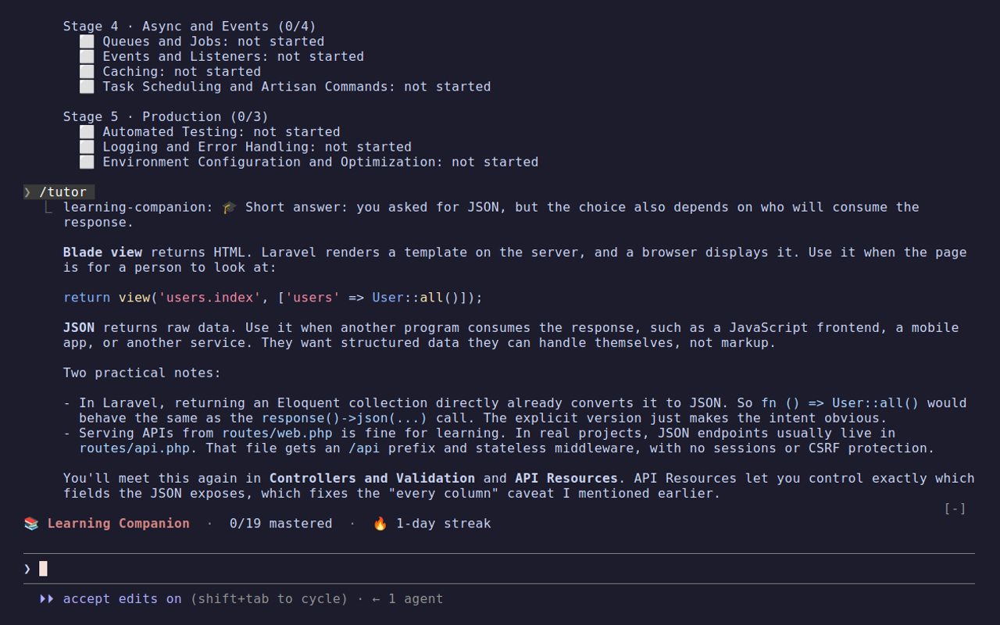
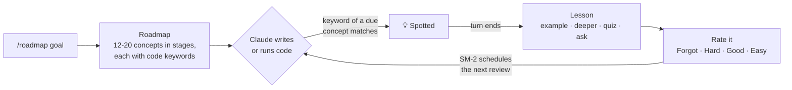

<div align="center">

# 📚 Learning Companion

**Learn while you ship.** A Claude Code plugin that turns the code Claude writes for you into lessons,
quizzes and spaced-repetition reviews, tied to a roadmap of what you want to master.

[](https://github.com/Komeyl94/claude-learning-companion/actions/workflows/test.yml)
[](package.json)
[](https://claude.com/claude-code)
[](#-privacy)
[](LICENSE)

[Quick start](#-quick-start) · [How it works](#-how-it-works) · [Commands](#-commands) · [Settings](#%EF%B8%8F-settings) · [Privacy](#-privacy) · [FAQ](#-faq) · [Contributing](#-contributing)

</div>

---

## Why

AI writes the code, and you ship faster. But the routing, the ORM relationships and the queue workers
pass by without sticking. A week later you could not write them yourself.

Learning Companion catches those moments. When Claude uses a concept from your roadmap, you get a short,
interactive lesson **about the code that was just written**. Then spaced repetition brings it back right
before you would forget it.

- 🎯 **A real roadmap.** 12–20 concepts in ordered stages, from fundamentals to production.
- 👀 **Spotted in context.** Concepts are detected in what Claude writes or runs, not in a separate course.
- 🧠 **Lessons, not one-liners.** Explanation, examples, a deeper dive, a quiz, or your own question.
- 🔁 **Spaced repetition.** [SM-2](https://en.wikipedia.org/wiki/SuperMemo#Description_of_SM-2_algorithm), the algorithm behind Anki, schedules each review. `/practice` catches up on everything due.
- 🆕 **Learn on demand.** `/learn` teaches the next concept on your roadmap, no code needed.
- 🎓 **A tutor on the side.** `/tutor` answers questions about the current session, even mid-turn.
- 📝 **Notes you keep.** Every lesson is saved as Markdown, one file per concept.
- 📈 **Visible progress.** Per-stage progress bars, a daily streak, and several roadmaps at once.
- 📤 **Share and export.** Hand a roadmap to a teammate, or export it as Anki cards.

## 🎬 What it looks like

<p align="center">
  
</p>

Claude adds a route while you work. When the turn ends, a lesson explains the concept **in that code**,
and you choose what comes next:

<table>
  <tr>
    <td width="50%"><br><sub><b>Lesson.</b> Explanation tied to your code, then example, deeper, quiz or your own question.</sub></td>
    <td width="50%"><br><sub><b>Quiz.</b> One multiple-choice question about the code you just saw.</sub></td>
  </tr>
  <tr>
    <td width="50%"><br><sub><b>Rating.</b> Your quiz result suggests the rating; SM-2 schedules the next review.</sub></td>
    <td width="50%"><br><sub><b>Progress.</b> Every concept by stage, and a streak on the status line.</sub></td>
  </tr>
  <tr>
    <td colspan="2"><br><sub><b>Tutor.</b> <code>/tutor</code> answers a side question using what happened in your session.</sub></td>
  </tr>
</table>

<sub>Recorded with <a href="https://github.com/charmbracelet/vhs">vhs</a> from <a href="demo/demo.tape"><code>demo/demo.tape</code></a>, in a real Claude Code session.</sub>

## 🚀 Quick start

**Requires** [Claude Code](https://claude.com/claude-code) 2.1.288 or later (function-hook plugins).

From your shell:

```bash
claude plugin marketplace add Komeyl94/claude-learning-companion
claude plugin install learning-companion@learning-companion
```

Or from inside a Claude Code session:

```text
/plugin marketplace add Komeyl94/claude-learning-companion
/plugin install learning-companion@learning-companion
/reload-plugins
```

**Where it runs:** the terminal CLI, IDE extensions, and the Claude Desktop **Code** tab (local and SSH
sessions; install with **+** → **Plugins** → **Add plugin** or the commands above). Cloud sessions,
including Claude Code on the web (claude.ai/code), don't load plugins, so it doesn't run there.

Start a session and give it a goal:

```text
/roadmap Laravel backend
```

That's it. Keep working as usual: lessons show up when Claude touches a concept that is due.
Want to study right now? `/learn` starts the next concept, and `/practice` goes through what is due.

## 🧭 How it works



1. **Roadmap.** Your goal becomes 12–20 concepts in 3–6 stages. Each concept has keywords as they appear
   in source code (`route::`, `hasmany`, `$table->`).
2. **Spotting.** Every `Write`, `Edit`, `MultiEdit`, `NotebookEdit` and `Bash` call is matched against the
   keywords of concepts that are due. Matching is whole-word, so `get` never fires on `target`.
   Spotting only flags the concept; the tool call itself is never slowed down.
3. **Lesson.** When the turn ends, a 3–5 sentence explanation tied to that exact code, then a menu you can
   loop through as long as you like:

   | Option | You get |
   | --- | --- |
   | **Show an example** | A different, realistic example and what to notice in it |
   | **Go deeper** | How it works underneath, a common mistake, when not to use it |
   | **Quiz me** | A multiple-choice question, marked right or wrong on the spot |
   | **Other** | Type any question about the concept |
   | **Rate it** | Ends the lesson and schedules the review |

4. **Review.** Your rating feeds SM-2: intervals grow 1 day, 6 days, then by your ease factor. A concept
   counts as **mastered** once you rate it Good or Easy at an interval over 30 days. After a quiz, the
   suggested rating is offered first: Good when every answer was right, Hard otherwise.
5. **Notes.** The lesson is appended to `~/learning-notes/<roadmap>/<concept>.md`, so you can reread it later.

Concepts that never come up in your code are not left behind: `/learn` teaches them in roadmap order,
and `/practice` reviews whatever is due.

## ⌨️ Commands

| Command | What it does |
| --- | --- |
| `/roadmap <goal>` | Builds a roadmap. For a goal you already have, updates it instead |
| `/learn [#\|name]` | Teaches the next concept you have not started yet |
| `/practice [#\|name]` | Goes through every concept due for review, one lesson after another |
| `/progress [#\|name]` | Every roadmap in full, or just one, by stage |
| `/tutor <question>` | Asks a side question at any time, even while Claude is working |
| `/roadmap` | Lists your roadmaps, one line each, with progress and due reviews |
| `/roadmap update <#\|name>` | Regenerates a roadmap and **keeps your progress** |
| `/roadmap remove <#\|name>` | Deletes a roadmap and its progress, after you confirm |
| `/roadmap export <#\|name> [anki]` | Writes the roadmap to a file: JSON to share, or Anki cards |
| `/roadmap import <file>` | Adds a shared roadmap, or merges it into yours for the same goal |

A roadmap is named by its number in `/roadmap`, its goal, or a unique part of the goal: `/progress 2`,
`/roadmap update docker`.

<details>
<summary><b>More about multiple roadmaps, updates, sharing and the tutor</b></summary>

<br>

- **Several roadmaps.** Learning Laravel and Docker at the same time? Add both. Concepts are spotted from
  every roadmap, and the status line counts them all.
- **Updates keep progress.** A concept with the same name keeps its review schedule and gets the new
  keywords. A concept you have already studied is never dropped, even when the new roadmap leaves it out.
- **Built for your stack.** `/roadmap` reads the dependency manifest in your project (`package.json`,
  `composer.json`, `requirements.txt`, `pyproject.toml`, `go.mod`, `Cargo.toml`, `Gemfile`, `pom.xml`,
  `build.gradle`), so keywords match the libraries you actually use.
- **Share with a team.** `/roadmap export 1` writes `<goal>.roadmap.json` without your progress.
  Teammates run `/roadmap import <file>` to start from the same roadmap.
- **Anki.** `/roadmap export 1 anki` writes `<goal>.anki.txt`, one card per concept with a short
  definition on the back. In Anki, use File → Import.
- **`/tutor` sees your session.** Like `/btw`, it answers over the current conversation, so "why did Claude
  use a job here?" just works. It never uses tools or changes anything. In a fresh session it answers
  without that context.

</details>

## ⚙️ Settings

Change them in `/config`, under Learning Companion.

| Setting | Default | What it does |
| --- | --- | --- |
| Lesson model | `haiku` | Model for roadmaps, lessons and quizzes: `haiku`, `sonnet` or `opus` |
| Lessons while you work | on | Off: no automatic lessons, only `/learn` and `/practice` |
| Automatic lessons per day | `5` | Cap on automatic lessons; `0` for no limit. `/learn` and `/practice` are never capped |
| Notes folder | `~/learning-notes` | Where lessons are saved as Markdown, including any code they quote; empty to turn notes off |

## 🔒 Privacy

- **No API key, no third party.** Every model call goes through your own Claude Code session.
- **Secret files are never read.** Writes to `.env*`, `*.pem`, `*.key`, SSH keys, `credentials`,
  `secrets.*`, `.npmrc` and `.netrc` are skipped entirely.
- **Snippets are redacted first.** For other code, at most 500 characters are used. API keys, tokens,
  passwords, URL credentials and private keys are replaced with `[REDACTED]` before anything is kept or
  sent to the model. The snippet itself is dropped from the plugin's store when the lesson ends.
- **Lesson notes stay on disk.** Notes are on by default and saved to `~/learning-notes`. A lesson can
  quote the (redacted) code it was about, so those quotes stay in your notes until you delete them.
  To turn notes off, clear the Notes folder setting in `/config`.
- **Local state.** Roadmaps and review schedules live in the plugin's own store under
  `~/.claude/plugins/store/`.
- **Project manifests, not code.** `/roadmap` reads only dependency manifests, redacted the same way,
  and only to pick keywords.

## ❓ FAQ

<details>
<summary><b>Does it cost extra?</b></summary>

<br>

It uses your Claude Code session, so it counts toward the usage you already have. Roadmaps and lessons
run on Haiku to keep that small. `/tutor` reuses your session's cached conversation.
</details>

<details>
<summary><b>Will it interrupt me all the time?</b></summary>

<br>

No. At most one concept is picked up per turn, only concepts that are due for review are spotted, the
lesson waits until Claude has finished, and there are at most 5 automatic lessons a day (change it in
`/config`). Close the dialog at any time to skip it, or turn automatic lessons off and study only with
`/learn` and `/practice`.
</details>

<details>
<summary><b>Does it work outside web development?</b></summary>

<br>

Yes. Any goal works: Rust, data engineering, Kubernetes, game development. Spotting works best where
concepts have distinctive APIs or keywords.
</details>

<details>
<summary><b>What happens in headless mode (<code>claude -p</code>)?</b></summary>

<br>

Commands work. Lessons need someone to answer, so they are skipped.
</details>

<details>
<summary><b>I used version 2.0. Is my roadmap lost?</b></summary>

<br>

No. A 2.0 roadmap is upgraded on load. Run `/roadmap update 1` to grow it to a full roadmap while keeping
your review history.
</details>

## 🛠️ Contributing

Issues and pull requests are welcome.

```bash
git clone https://github.com/Komeyl94/claude-learning-companion.git
cd claude-learning-companion
claude --plugin-dir .            # run Claude Code with your local copy
claude plugin test .             # run the test suites
claude plugin validate --strict .
claude plugin eval . --runs 1    # grade roadmap and tutor quality with a model judge
```

CI runs `validate` and `test` on every push and pull request. Evals call a model, so run them locally
when you change a prompt.

Dialogs and the transcript only show up in a real terminal. [`tests/e2e/features.tape`](tests/e2e/features.tape)
drives a real Claude Code session with [vhs](https://github.com/charmbracelet/vhs) through every feature and
saves a screenshot of each step to `tests/e2e/out/`. Run it before a release.

| Path | Role |
| --- | --- |
| [`hooks/register.ts`](hooks/register.ts) | Hooks: commands, concept spotting (`tool.call`), lessons (`turn.complete`), settings |
| [`hooks/sm2.ts`](hooks/sm2.ts) | Pure logic: SM-2, keyword matching, roadmap merging, parsing, progress views |
| [`hooks/study.ts`](hooks/study.ts) | Pure logic: what to study next, rating suggestions, streaks, notes, export |
| [`tests/`](tests) | Suites for `claude plugin test` |
| [`evals/`](evals) | Cases for `claude plugin eval` |
| [`demo/`](demo) | [vhs](https://github.com/charmbracelet/vhs) script that records `docs/demo.gif` and the screenshots |
| [`docs/`](docs) | The demo GIF and screenshots used in this README |

Keep pure logic in `sm2.ts` and `study.ts` so it can be tested without the engine, and add a test with
each change.

**Releasing.** Bump `version` in `.claude-plugin/plugin.json` and `package.json`, add a section to
[`CHANGELOG.md`](CHANGELOG.md), then tag `vX.Y.Z` and publish a GitHub release with that section as its notes.
Installs follow `main`, so a push reaches users on their next `claude plugin marketplace update`.

## 📄 License

[MIT](LICENSE) © Komeyl Mohebian
